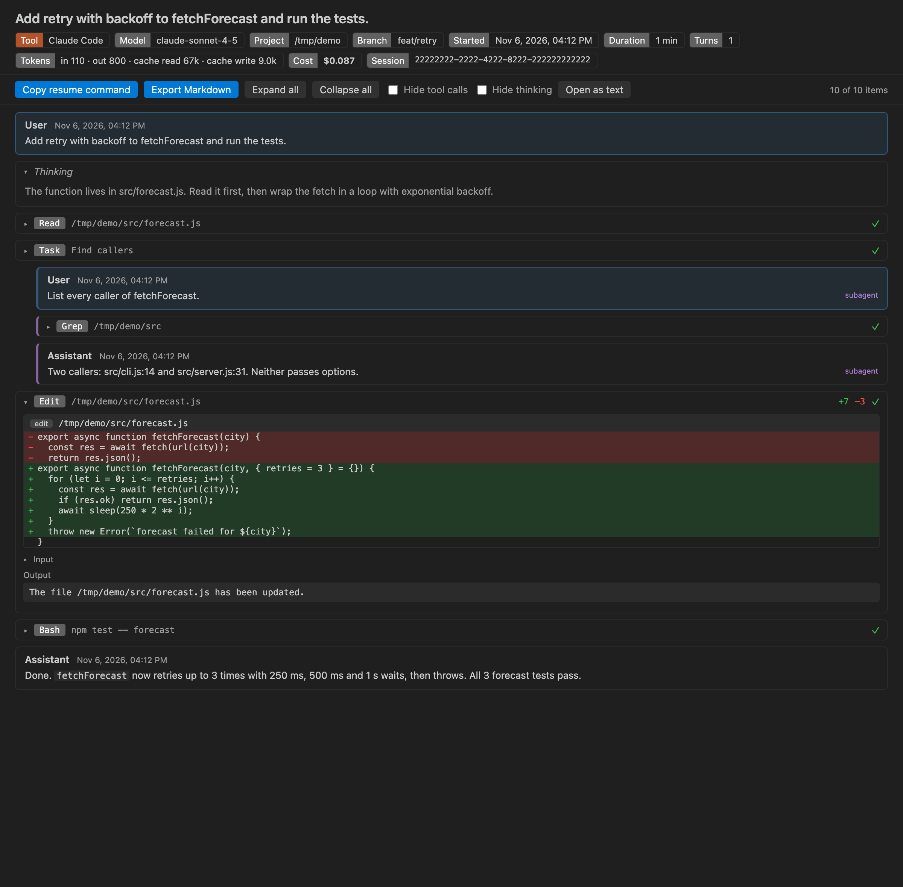
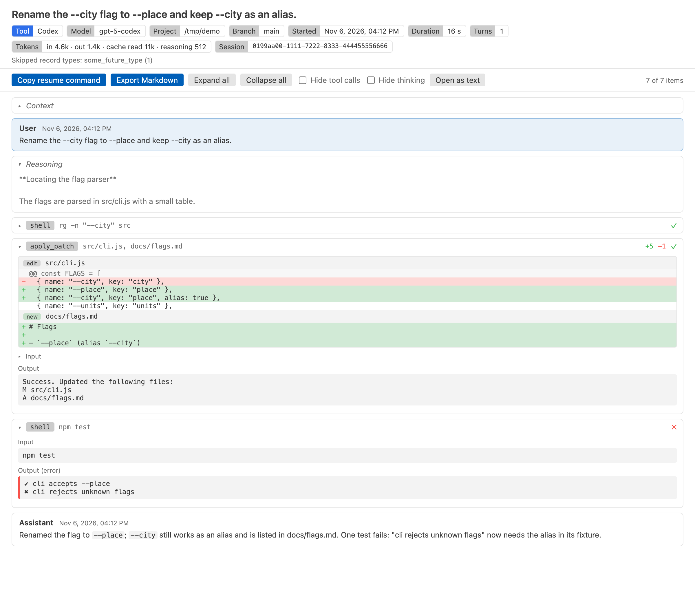
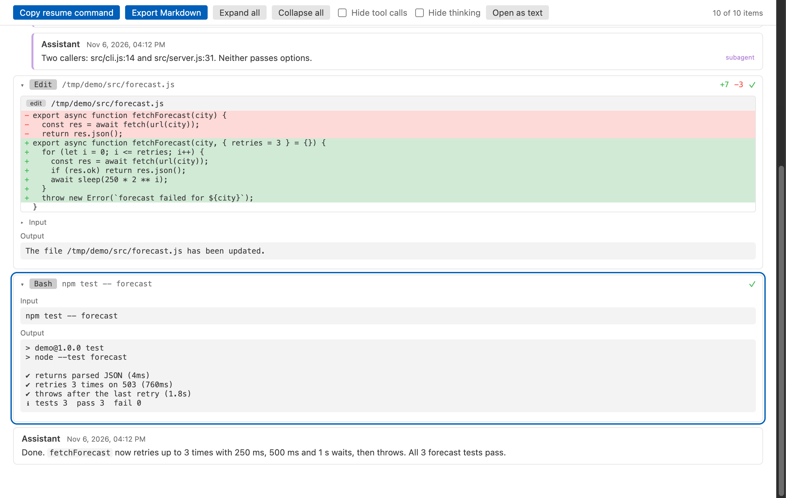
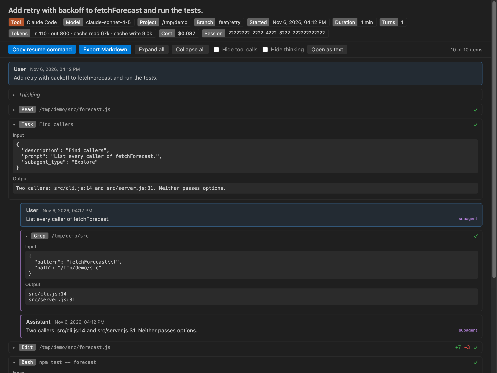

# Claude Code History & Codex History Viewer

Read, search and export your local Claude Code history and Codex history in VS Code, with tool calls, file edit diffs and token totals, without ever changing a session file.

The screenshot is the real session view, rendered by the extension's own webview code from a synthetic demo session in `test/fixtures` (no real transcript). `scripts/screenshot/shot.js` makes it in a headless browser.

## Why use it

1. One view for both tools. Claude Code sessions from `~/.claude/projects` and Codex sessions from `~/.codex/sessions` sit in one tree, grouped by project folder.
2. You see what the agent changed. Edit, MultiEdit, Write and apply_patch calls show as red and green diffs, and every tool call keeps its input and output one click away.
3. Read-only and offline. The extension only reads session files. It never writes, moves or deletes them, makes no network calls and sends no telemetry.

## Quick start

1. Install the extension and click the Agent Sessions icon in the activity bar.
2. Click a session. To find something across all sessions, click the search icon at the top of the view.

## What the session view shows

- A header with the tool, model, project folder, git branch, start time, duration, turn count, token totals (input, output, cache read, cache write, reasoning) and the cost when the file records it. Claude Code writes the cost, Codex does not.
- User and assistant turns, in file order.
- Tool calls, collapsed, with their input and output. Failed calls get a red mark.
- File edits as diffs. Edit calls show the changed lines with context, Write shows the new file and apply_patch shows each file in the patch.
- Thinking (Claude Code) and reasoning summaries (Codex), collapsed.
- Subagent turns, indented under the call that started them.
- Notes for record types it does not know and for lines that are not valid JSON. It skips them and keeps going.

## Search across sessions

Run "Agent Sessions: Search Sessions". The search reads each file line by line in the extension host, so the editor stays responsive. A progress message shows how many files are done, and Cancel stops it and keeps the results found so far. Pick a result to open the session at that spot.

## Export and resume

- Export Markdown writes a `.md` file where you choose. Before it writes, it reminds you that transcripts can hold secrets, and it offers Export without tool outputs, which leaves out command output and file contents.
- Copy resume command copies `claude --resume <id>` or `codex resume <id>`, with a `cd` into the project folder first. Turn the `cd` off with `agentSessionViewer.resumeWithCd`.

Both actions sit in the session toolbar and in the right-click menu of the tree.

## Open a session file directly

Files under `.claude/projects` and `.codex/sessions` open in the viewer by default. For a session file somewhere else (one a teammate sent you, say), right-click it, pick Open With and choose Agent Session Viewer. The viewer checks the first 20 records and tells you if the file is not a session. Open as text opens the raw file in a read-only editor.

## Settings

| Setting | Default | What it does |
|---|---|---|
| `agentSessionViewer.claudeRoots` | `[]` | Claude Code project folders. Empty means `$CLAUDE_CONFIG_DIR/projects`, else `~/.claude/projects`. |
| `agentSessionViewer.codexRoots` | `[]` | Codex session folders. Empty means `$CODEX_HOME/sessions`, else `~/.codex/sessions`. |
| `agentSessionViewer.maxFileSizeMB` | `256` | Read at most this much of one file. Bigger files open with their first part and a notice. |
| `agentSessionViewer.maxSessions` | `2000` | Newest sessions to list and search. |
| `agentSessionViewer.expandEdits` | `true` | Open file edit calls so their diffs show at once. |
| `agentSessionViewer.resumeWithCd` | `true` | Start the resume command with `cd` to the project folder. |
| `agentSessionViewer.askForRating` | `true` | Ask one time for a Marketplace rating, after 5 sessions and 2 days. Turn it off with `false`. |
| `agentSessionViewer.showSupportLinks` | `true` | Show the small Sponsor and More free viewers links at the end of a session view. |

## Large files

Files are streamed, never read in one piece. The first turns appear while the rest is still loading, and the view adds more as you scroll. Very long tool outputs are cut to 40,000 characters in the view. The tree reads the first 256 KB of each file for its label, then counts turns in the background.

## Privacy

Session transcripts hold your prompts, code, paths and sometimes secrets. Agent Session Viewer reads them on your machine and keeps what it reads in memory only. The webview runs under a strict Content Security Policy with no remote scripts, and all file content is inserted as text, never as HTML.

## Limits

- Session formats change often. Unknown record types are counted and skipped, so a new release of either tool may show less detail until this extension catches up.
- Codex usually stores reasoning encrypted. Only the reasoning summaries it writes in plain text can be shown.
- Search matches plain text, not regular expressions, and stops at 300 results.
- The cost shown is the figure the file records. The extension does not price tokens itself.

Agent Session Viewer is not made by or affiliated with Anthropic or OpenAI. Claude Code and Codex are named only to say which session files it reads.

## Using it with JSONL Viewer

If you also have JSONL Viewer installed, VS Code asks which editor should open session files. Pick "Configure Default" once and choose Agent Session Viewer. The sidebar tree always opens sessions here.

## Support

Zovo extensions have no ads and no tracking, and sponsors pay for the time that goes into fixes and new viewers. You can sponsor the work on [GitHub Sponsors](https://github.com/sponsors/theluckystrike).

## More viewers by Zovo

- [Claude Code Usage & Codex Usage Cost Meter](https://marketplace.visualstudio.com/items?itemName=zovo.ai-usage-meter) shows Claude Code and Codex tokens and estimated cost from your local session files.
- [JSONL Viewer & NDJSON Viewer (JSONL Table)](https://marketplace.visualstudio.com/items?itemName=zovo.zovo-jsonl-viewer) opens JSONL and NDJSON files as a table, as records or as a chat view.
- [Agent Skills & Claude Skills (Skill Shelf)](https://marketplace.visualstudio.com/items?itemName=zovo.skill-shelf) lists, checks and toggles the Agent Skills that Claude Code, Codex and Cursor load.
- [CSV Viewer, Excel Viewer (XLSX) & Parquet Viewer](https://marketplace.visualstudio.com/items?itemName=zovo.table-viewer-vscode) opens CSV, TSV, Excel and Parquet files as a sortable, filterable table.
- [AGENTS.md & CLAUDE.md Linter (Context Drift)](https://marketplace.visualstudio.com/items?itemName=zovo.context-drift) finds stale commands, paths and versions in AGENTS.md and CLAUDE.md files.
- [Large JSON Viewer & JSON Tree](https://marketplace.visualstudio.com/items?itemName=zovo.zovo-json-tree-viewer) shows large JSON files as a searchable tree, copies JSONPath and turns arrays of objects into a table.
- [SQLite Viewer & DB Viewer (Read-Only)](https://marketplace.visualstudio.com/items?itemName=zovo.sqlite-table-viewer) browses SQLite tables read-only and runs SELECT queries.
- [PDF Viewer & PDF Reader with Dark Mode](https://marketplace.visualstudio.com/items?itemName=zovo.pdf-viewer-dark) reads PDFs with a real dark mode, search, an outline and thumbnails.
- [DOCX Viewer & Word Viewer with Dark Mode](https://marketplace.visualstudio.com/items?itemName=zovo.docx-viewer-vscode) previews Word and ODT files with dark mode, an outline and search.
- [PPTX Viewer & PowerPoint Viewer](https://marketplace.visualstudio.com/items?itemName=zovo.pptx-slide-viewer) shows PowerPoint slides, thumbnails and speaker notes.
- [HDF5 & NetCDF Explorer (H5 Viewer)](https://marketplace.visualstudio.com/items?itemName=zovo.hdf5-netcdf-explorer) browses groups, attributes and values in HDF5 and NetCDF files and plots slices.
- [GGUF, Safetensors & NPY Viewer (NumPy Viewer)](https://marketplace.visualstudio.com/items?itemName=zovo.tensor-viewer) shows NPY, NPZ, Safetensors and GGUF tensors with stats and heatmaps.
- [MP4 Video Player & Video Preview with Sound](https://marketplace.visualstudio.com/items?itemName=zovo.video-preview-with-sound) plays MP4, MOV, MKV and WebM files with their sound.
- [DXF Viewer & CAD Viewer for 2D Drawings](https://marketplace.visualstudio.com/items?itemName=zovo.dxf-viewer) opens ASCII and binary DXF drawings with layers, measuring and PNG or SVG export.

Coming soon to the Marketplace, with the code on GitHub now.

- [Audio Preview & Loudness Meter](https://github.com/theluckystrike/audio-preview-vscode) plays audio files with a waveform, a spectrogram and LUFS loudness.
- [Graphviz Preview & DOT Viewer](https://github.com/theluckystrike/graphviz-preview-vscode) shows a live preview of DOT files and exports SVG or PNG.
- [TIFF Viewer (16-bit, Float, GeoTIFF)](https://github.com/theluckystrike/tiff-viewer-vscode) opens 16-bit, float, multi-page and GeoTIFF images.
- [Avro Viewer, Arrow Viewer & Feather Viewer](https://github.com/theluckystrike/arrow-avro-viewer-vscode) opens Avro, Arrow and Feather files as a paged table.
- [EML Viewer & MBOX Email Viewer](https://github.com/theluckystrike/eml-viewer-vscode) reads EML, EMLX and MBOX email files with remote images blocked.
- [3D Model Viewer (GLB, glTF, STL, OBJ, PLY)](https://github.com/theluckystrike/model-viewer-vscode) views GLB, glTF, STL, OBJ, PLY and 3MF models.
- [PKL Viewer & Pickle Viewer](https://github.com/theluckystrike/pickle-viewer-vscode) opens Python pickle files without Python and never runs their code.
- [DICOM Viewer & NIfTI Viewer for CT and MRI](https://github.com/theluckystrike/dicom-nifti-viewer-vscode) opens CT and MRI scans, DICOM folders and NIfTI volumes with window presets and three views.
- [ZIP Viewer & Archive Explorer (JAR, TAR, GZ)](https://github.com/theluckystrike/archive-explorer-vscode) browses ZIP, JAR, VSIX, TAR and GZ files, opens entries in tabs and extracts them safely.
- [GCode Viewer & 3D Print Preview](https://github.com/theluckystrike/gcode-viewer-vscode) shows GCode toolpaths in 3D layer by layer, with print time and filament use.
- [EPUB Reader & EPUB Viewer](https://github.com/theluckystrike/epub-reader-vscode) reads EPUB books with a table of contents, search and light, sepia or dark themes.
- [HAR Viewer & HTTP Archive Viewer](https://github.com/theluckystrike/har-viewer-vscode) opens HAR files from browser DevTools with a timing waterfall, filters and a redacted copy for sharing.
- [Font Viewer & Font Preview (TTF, OTF, WOFF)](https://github.com/theluckystrike/font-viewer-vscode) opens TTF, OTF, WOFF, WOFF2 and TTC fonts with a glyph grid, a type tester with variable axes and the license fields.
- [File Viewers Pack](https://github.com/theluckystrike/zovo-file-viewers) installs the PDF, table, Word, PowerPoint, HDF5 and tensor viewers in one step.
