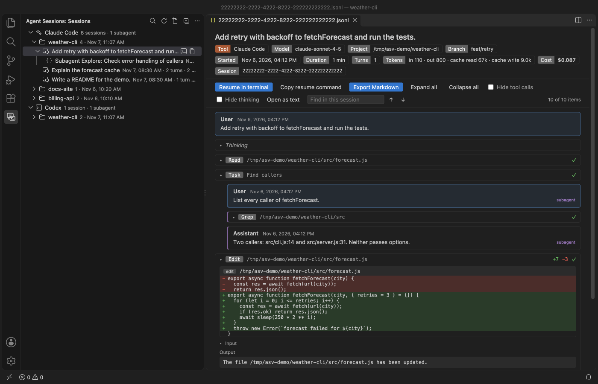
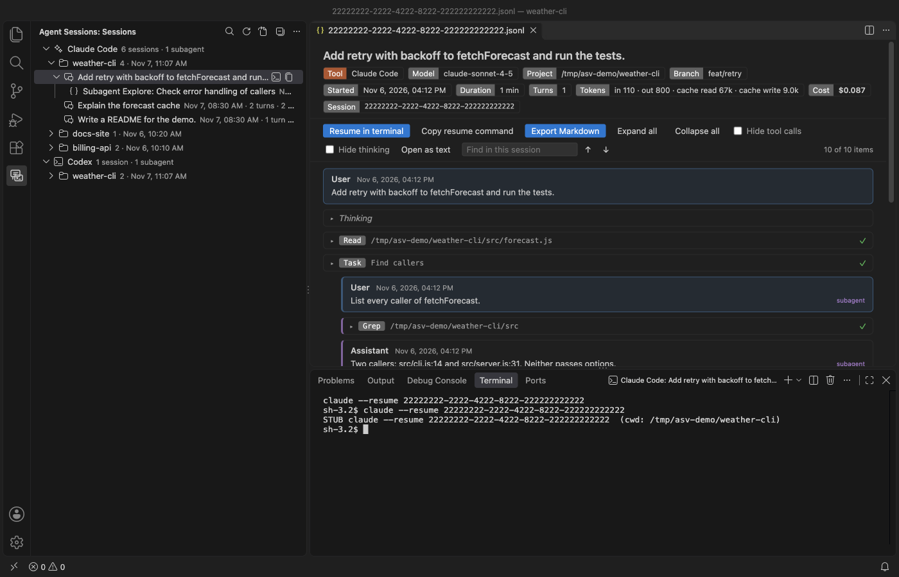
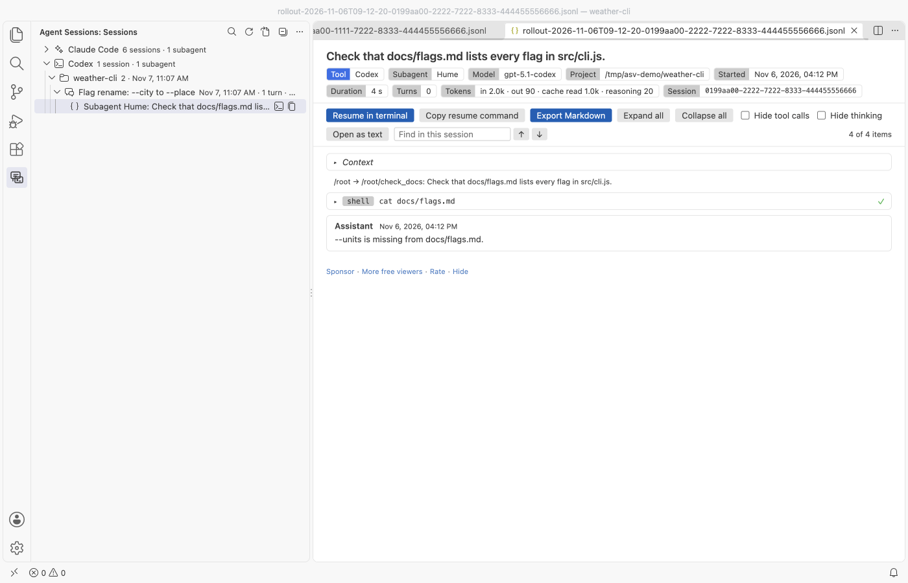
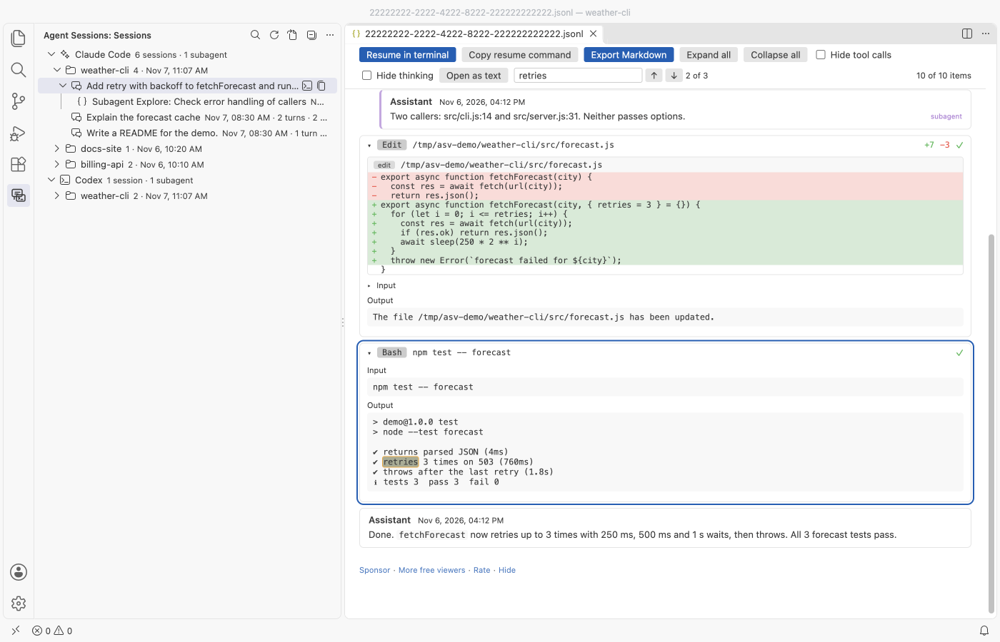

# Claude Code History & Codex History Viewer

Read, search and resume your local Claude Code and Codex sessions in VS Code: prompts, replies, subagents, tool calls, file edit diffs and token totals. Free, with no paywall, no account and no history limit. It only reads your session files and never changes, moves or deletes them.

All screenshots are from VS Code 1.142 running this extension on invented demo sessions, not real transcripts.

## Why use it

1. One tree for both tools. Claude Code sessions from `~/.claude/projects` and Codex sessions from `~/.codex/sessions` sit in one view, grouped by project folder. Subagents sit under the session that started them.
2. Resume in one click. Resume in terminal opens a terminal in the session's project folder and runs `claude --resume <id>` or `codex resume <id>` there.
3. Find it again. Search every session, then the session opens at the match with your words in its find box and every match counted, even inside collapsed tool output.
4. Read-only, free and offline. No paywall, no sign-in, no telemetry and no network calls. Your whole history is there, not only the last few days.

## Quick start

1. Install the extension and click the Agent Sessions icon in the activity bar.
2. Click a session to read it. Click the terminal icon next to it to resume it.
3. To find something across all sessions, click the search icon at the top of the view.

## Resume a session

- Resume in terminal is in the session toolbar, as an icon on each session in the tree, and in the right-click menu. It types the command in a new VS Code terminal in the project folder. If that folder is gone, the terminal opens in the default folder and a note tells you.
- Copy resume command copies the same command with a `cd` into the project folder first. Turn the `cd` off with `agentSessionViewer.resumeWithCd`.

## Subagents

Claude Code saves each subagent run as its own file under `<session>/subagents/`, and Codex saves each subagent thread as its own rollout file. Both show up under the session that started them, named by the agent's type or nickname and its task. Claude Code subagents that older versions kept inside the main file still show indented under their Task call.

## What the session view shows

- A header with the tool, model, project folder, git branch, start time, duration, turn count, token totals (input, output, cache read, cache write, reasoning) and the cost when the file records it. Claude Code writes the cost, Codex does not.
- User and assistant turns, in file order.
- Tool calls, collapsed, with their input and output. Failed calls get a red mark.
- File edits as diffs. Edit calls show the changed lines with context, Write shows the new file and apply_patch shows each file in the patch.
- Thinking (Claude Code) and reasoning summaries (Codex), collapsed.
- The thread name from Codex's `session_index.jsonl`, so threads you renamed in Codex keep their names.
- Notes for record types it does not know and for lines that are not valid JSON. It skips them and keeps going.

## Search across sessions

Run "Agent Sessions: Search Sessions". The search reads each file line by line in the extension host, so the editor stays responsive. A progress message shows how many files are done, and Cancel stops it and keeps the results found so far. Pick a result to open the session at that spot.

The find box in the session toolbar searches the whole session, including tool inputs, outputs, diffs and thinking that are collapsed. Enter goes to the next match and Shift+Enter to the one before. It opens each match as you get to it.

## Export

Export Markdown writes a `.md` file where you choose. Before it writes, it reminds you that transcripts can hold secrets, and it offers Export without tool outputs, which leaves out command output and file contents. It is in the session toolbar and in the right-click menu of the tree.

## Open a session file directly

Files under `.claude/projects` and `.codex/sessions` open in the viewer by default. For a session file somewhere else (one a teammate sent you, say), right-click it, pick Open With and choose Agent Session Viewer. The viewer checks the first 20 records and tells you if the file is not a session. Open as text opens the raw file in a read-only editor.

## Settings

| Setting | Default | What it does |
|---|---|---|
| `agentSessionViewer.claudeRoots` | `[]` | Claude Code project folders. Empty means `$CLAUDE_CONFIG_DIR/projects`, else `~/.claude/projects`. |
| `agentSessionViewer.codexRoots` | `[]` | Codex session folders. Empty means `$CODEX_HOME/sessions`, else `~/.codex/sessions`. |
| `agentSessionViewer.maxFileSizeMB` | `256` | Read at most this much of one file. Bigger files open with their first part and a notice. |
| `agentSessionViewer.maxSessions` | `2000` | Newest sessions to list and search. |
| `agentSessionViewer.expandEdits` | `true` | Open file edit calls so their diffs show at once. |
| `agentSessionViewer.resumeWithCd` | `true` | Start the resume command with `cd` to the project folder. |
| `agentSessionViewer.askForRating` | `true` | Ask one time for a Marketplace rating, after 5 sessions and 2 days. Turn it off with `false`. |
| `agentSessionViewer.showSupportLinks` | `true` | Show the small Sponsor and More free viewers links at the end of a session view. |

## Large files

Files are streamed, never read in one piece. The first turns appear while the rest is still loading, and the view adds more as you scroll. Very long tool outputs are cut to 40,000 characters in the view. The tree reads the first 256 KB of each file for its label, then counts turns in the background.

## Privacy

Session transcripts hold your prompts, code, paths and sometimes secrets. Agent Session Viewer reads them on your machine and keeps what it reads in memory only. It has no delete, move or rename command, and it keeps no copy or index of your sessions on disk. The webview runs under a strict Content Security Policy with no remote scripts, and all file content is inserted as text, never as HTML.

## Limits

- Session formats change often. Unknown record types are counted and skipped, so a new release of either tool may show less detail until this extension catches up.
- Codex usually stores reasoning encrypted. Only the reasoning summaries it writes in plain text can be shown.
- Search matches plain text, not regular expressions, and stops at 300 results.
- Resume in terminal types the command for you. Claude Code or Codex must be installed and on the terminal's PATH.
- It reads Claude Code and Codex only. Cursor, Copilot and Gemini CLI sessions are not supported yet.
- The cost shown is the figure the file records. The extension does not price tokens itself.

Agent Session Viewer is not made by or affiliated with Anthropic or OpenAI. Claude Code and Codex are named only to say which session files it reads.

## Using it with JSONL Viewer

If you also have JSONL Viewer installed, VS Code asks which editor should open session files. Pick "Configure Default" once and choose Agent Session Viewer. The sidebar tree always opens sessions here.

## Support Zovo

Zovo extensions are free, with no ads and no tracking. They are made by [theluckystrike](https://github.com/theluckystrike) on GitHub. If this one saves you time, you can support the work:

- [Sponsor on GitHub](https://github.com/sponsors/theluckystrike)
- [Follow theluckystrike on GitHub](https://github.com/theluckystrike)

## More tools by Zovo

- [Claude Code Usage, Codex Usage & Gemini CLI Usage Meter](https://marketplace.visualstudio.com/items?itemName=zovo.ai-usage-meter) shows Claude Code and Codex tokens and estimated cost from your local session files.
- [JSONL Viewer, Large JSONL Table & NDJSON Viewer](https://marketplace.visualstudio.com/items?itemName=zovo.zovo-jsonl-viewer) opens JSONL and NDJSON files as a table, as records or as a chat view.
- [Agent Skills & Claude Skills Manager (Skill Shelf)](https://marketplace.visualstudio.com/items?itemName=zovo.skill-shelf) lists, checks and toggles the Agent Skills that Claude Code, Codex and Cursor load.
- [AGENTS.md & CLAUDE.md Linter (Context Drift)](https://marketplace.visualstudio.com/items?itemName=zovo.context-drift) finds stale commands, paths and versions in AGENTS.md and CLAUDE.md files.
- [Large JSON Viewer, JSON Browser & JSON Tree](https://marketplace.visualstudio.com/items?itemName=zovo.zovo-json-tree-viewer) shows large JSON files as a searchable tree, copies JSONPath and turns arrays of objects into a table.

See [all Zovo extensions on the Marketplace](https://marketplace.visualstudio.com/publishers/zovo).
